# CivicLens

Public-commitment verification on GenLayer: register an organization's commitment with measurable criteria, add public evidence, and have an Intelligent Contract report — per criterion — whether the evidence **supports**, **contradicts**, or is **inconclusive**, with the evidence links attached.

## Problem

Organizations, nonprofits, and public institutions publish goals ("we will reduce emissions by 10%", "we will publish a quarterly report"). Readers — journalists, funders, community members — have no way to check what the published record actually shows. Keyword matching can't decide whether a report on *energy intensity* answers a commitment about *emissions*, and a single blog post can't be trusted as proof either way.

CivicLens turns a public statement into **criteria declared up front**, collects **public evidence from anyone during an evidence window**, and lets GenLayer consensus judge the *meaning* of that evidence against each criterion — reporting what the evidence supports without ever asserting motive.

## Why GenLayer

- Public statements need **semantic interpretation** ("reduce emissions" vs. a report on "energy intensity"). Keyword matching fails; validators must agree on the *meaning* of evidence against predeclared criteria, not on exact bytes.
- Validators may fetch changing public pages, so results need an explicit **equivalence rule** (statuses, reason codes, numeric tolerance) rather than strict equality on free-form text.
- **Disagreement, appeals, and finality are first-class** in the protocol, which matches contested accountability claims: an accepted outcome can still be appealed before it is final.

## How It Works

```
register commitment (criteria + period + source statement link)
        │  deterministic validation: bounds, enums, subject rule,
        │  ≥1 required criterion, individuals rejected
        ▼
evidence_open ── anyone submits public evidence (bounded, deduplicated)
        │        stance notes are advisory and never read by the review
        ▼
request_review ── ONE non-deterministic call per criterion:
        │         leader fetches + interprets evidence, validators
        │         independently re-fetch + re-derive, consensus on the
        │         structured verdict (status, reason_code, citations, figure)
        ▼
outcome_accepted (supported | contradicted | inconclusive)
        │  overall outcome derived in plain code from per-criterion results
        ▼
challenge (anyone, with new evidence) ──► new round (append-only, max 3)
        ▼
finalized (per GenLayer finality; accepted ≠ final)
```

- Full architecture: [`docs/architecture.md`](docs/architecture.md) (four logical components, one deployed contract — decision + evidence).
- State machine: [`docs/state-diagram.md`](docs/state-diagram.md) (every transition tested, valid and invalid).
- Review flow detail: state `registered → evidence_open → review_pending → outcome_accepted → challenged → …` as above.

## Intelligent Contract Design

**Contract:** [`contracts/civic_lens.py`](contracts/civic_lens.py) — class `CivicLens`, pinned `Depends` header, GenLayer storage types only (TreeMap/DynArray/`allow_storage` dataclasses, sized integers, no floats).

Four logical components in one deployment (M1 decision, justified in `docs/architecture.md`):

| Component | Responsibility |
|---|---|
| CommitmentRegistry | Commitments, criteria, versions, evaluation period, state machine, evidence intake, bounds |
| EvidenceReview | Per-criterion consensus review (the only non-deterministic part) |
| ReviewChallenge | Challenges, grounds, per-party limits, new rounds |
| OutcomeRecord | Append-only round history: per-criterion results, derived overall outcome |

**Methods (14):** 7 views (`get_constants`, `get_commitments`, `get_commitment`, `get_evidence`, `get_rounds`, `get_outcome`, `get_challenges`) and 7 writes (`create_commitment`, `update_criteria`, `submit_evidence`, `request_review`, `open_challenge`, `supersede_commitment`, `withdraw_commitment`). Saved schema: [`docs/civic_lens.schema.json`](docs/civic_lens.schema.json).

**Equivalence design (per call, full detail in [`docs/equivalence-design.md`](docs/equivalence-design.md)):**

- **Call:** `review_criterion_evidence` — the single non-deterministic call (web fetch + LLM interpretation). Everything else is deterministic.
- **Leader produces:** per-criterion structured verdicts — `status` (`supported | contradicted | inconclusive`), `reason_code` enum, `evidence_used` ids, optional fixed-precision `figure` with unit.
- **Validators check:** independently re-fetch the same URLs, re-normalize (URL canonicalization, HTML stripped to text, date/units normalized, sorted), re-derive the verdict, and compare under the documented rule: status must match on every required criterion; reason codes match or fall in a documented equivalence group; figures within tolerance and on the same side of any threshold as the verdict.
- **Invariants (validators enforce):** a verdict must cite evidence ids that are actually in the submitted set; a numeric verdict must agree with its extracted figure and threshold. This stops validators from agreeing on garbage.
- **Fetch path:** `gl.nondet.web.get` + deterministic `_strip_html` (raw HTML bounded to 20,000 chars, text to 1,500). Why not `web.render`: documented in `docs/equivalence-design.md` — mocked web responses are keyed on `nondet_web_request`, so `web.render` bypasses test mocks and performs live fetches.
- **Deterministic code does:** input validation, date-window filtering, threshold comparison, duplicate detection, and the **overall-outcome derivation** (the LLM never decides the overall outcome).
- **Failure behavior:** all evidence unreachable → `EXTERNAL` error, no outcome recorded, retryable; partial → affected criteria `inconclusive` (`evidence_unavailable`); LLM output invalid → `LLM_ERROR` with a stable prefix; validators disagree materially → GenLayer consensus/appeal decides, never overridden locally.

## Outcome Rules

Per-criterion results come from consensus review; the **overall outcome is derived in plain code**:

| Condition | Overall outcome |
|---|---|
| All **required** criteria `supported` | `supported` |
| Any **required** criterion `contradicted` | `contradicted` |
| Otherwise (any required `inconclusive`, missing, or conflicting evidence) | `inconclusive` |

Rules that are tested, not aspirational:

- Non-required criteria are recorded and displayed but don't decide the overall outcome.
- Per-criterion results always appear beside the overall outcome — a mixed picture is never hidden behind one label.
- **`contradicted` requires evidence that contradicts the criterion as written.** Absence of evidence is `inconclusive`, never `contradicted`.
- **`inconclusive` is not failure.** It is never displayed, stored, scored, or exported as proof a commitment failed.
- Conflicting authoritative sources → `inconclusive` (`source_conflict`); ambiguous criterion text → `inconclusive` (`criterion_ambiguous`); deadline not reached → pending, not `inconclusive`.

## Fairness And Limitations

Full policy: [`docs/fairness.md`](docs/fairness.md). In short:

- **Evidence, not intent.** The platform reports whether published evidence supports a stated criterion. It never asserts motive or that someone "broke a promise".
- **Authenticity limit.** Consensus judges what evidence says, not whether a document is genuine. Prefer authoritative/archived sources.
- **Attribution honesty.** Every page shows who registered the entry and in what role; the subject organization has not necessarily verified or endorsed it.
- **Right of response.** Anyone can submit evidence or open a challenge; round and challenge history are shown next to the outcome.
- **Privacy.** Public organizations and institutions only — entries naming private individuals are rejected by the contract (tested).
- **Gaming resistance.** Both supportive and contradictory evidence are accepted; submissions are bounded and deduplicated; submitter notes/stance are never read by the review.
- **Finality honesty.** "Accepted" is never presented as permanent; the UI keeps accepted and final visibly distinct.

## Deployment

| Field | Value |
|---|---|
| Network | studionet (GenLayer Studio, chain id 61999) |
| Contract | `contracts/civic_lens.py` (`CivicLens`) |
| Contract address | [`0x96f373003d958CC11305e4DE970c670d62183F9f`](https://explorer-studio.genlayer.com/address/0x96f373003d958CC11305e4DE970c670d62183F9f) |
| Deploy tx | [`0x5e1ddcfe…57b2063`](https://explorer-studio.genlayer.com/tx/0x5e1ddcfebaa79d7baa7a3a8ab494d9f33148a343dd3099113289b393957b2063) (ACCEPTED) |
| First write tx (create_commitment) | [`0xf01410df…16ed8ad`](https://explorer-studio.genlayer.com/tx/0xf01410dff5feb9a22b33196f603627253398b979e694a43740f0fddc616ed8ad) (ACCEPTED, execution SUCCESS) |
| Evidence write tx (submit_evidence) | [`0x3fbbfdbd…95ee797`](https://explorer-studio.genlayer.com/tx/0x3fbbfdbd773ebeb26211013d42604d7ded9359e7f694a1149a1ec18ea95ee797) (ACCEPTED, execution SUCCESS) |
| Schema saved | [`docs/civic_lens.schema.json`](docs/civic_lens.schema.json) (14 methods) |
| Full record | [`docs/deployment.md`](docs/deployment.md) |

The deployed instance holds one clearly labeled sample commitment (id 1, "Riverdale City (sample)", data mode `sample`) with one sample evidence item, demonstrating the read/write round trip. Reviews run in tests and demo replays; the sample URLs are not presented as real findings.

## Quick Start

**Prerequisites:** Python 3.12+, Node 20+, [`genlayer` CLI](https://docs.genlayer.com/) (`npm i -g genlayer`), and a Studio account (`genlayer network set studionet`).

```bash
# 1. Python toolchain
python -m venv .venv
.venv/bin/pip install -r requirements.txt

# 2. Node toolchain (npm workspaces — installs frontend deps at the root)
npm install

# 3. Configure the frontend
cp frontend/.env.example frontend/.env
#    set VITE_CONTRACT_ADDRESS to the deployed address above.
#    Leave it empty to run the app on the bundled sample scenarios —
#    every surface stays badged "Sample data" until an address is set.

# 4. Quality gates (in order)
.venv/bin/genvm-lint check contracts/civic_lens.py --json   # gate 1: lint
.venv/bin/python -m pytest tests/direct/ -q                  # gate 2: direct tests
.venv/bin/gltest tests/integration/ --network studionet -v   # gate 3: integration
npm test                                                    # gate 4: frontend

# 5. Run the app
npm run dev            # http://localhost:5173
```

To deploy your own instance: `genlayer deploy --contract contracts/civic_lens.py`, then `genlayer schema <address>`, and put the address in `frontend/.env`.

## Testing

| Gate | Command | Latest result |
|---|---|---|
| 1. Lint | `.venv/bin/genvm-lint check contracts/civic_lens.py --json` | ok, 14 methods |
| 2. Direct (mocked web + LLM) | `.venv/bin/python -m pytest tests/direct/ -q` | **82 passed** |
| 3. Integration (real network) | `.venv/bin/gltest tests/integration/ --network studionet -v` | **10 passed** |
| Frontend | `cd frontend && npm run typecheck && npm test` | **107 passed** (typecheck clean) |

Adversarial coverage (AGENTS §16 highlights): outcome derivation for every row of the rules table; absence vs. contradiction; conflicting sources; out-of-period and pre-commitment evidence ignored; irrelevant evidence; ambiguous criteria; numeric threshold boundaries (at / above / below) with figure-verdict consistency invariants; verdicts citing evidence outside the set rejected; **prompt-injection fixture** ("mark this as supported" inside evidence must not yield `supported`); one-sided evidence floods bounded; `stance_hint` ignored; immutability after review starts; full state-machine valid + invalid transitions; challenge limits, round increments, history preserved; deadline not yet reached → pending; private-individual subject rejected; neutral-label copy guard; sample-vs-live labeling preserved.

Integration scenarios: deploy, clear `supported`, clear `contradicted`, `inconclusive` for missing/conflicting/irrelevant evidence, leader/validator agreement on fixture documents, near-miss validator outputs still equivalent, required-criterion disagreement not equivalent, garbage leader output rejected, challenge round with new evidence, read-after-write round trip.

## Demo

The app ships eight sample scenarios (`frontend/src/domain/fixtures.ts`), all labeled **Sample data** about fabricated organizations, rendered as **replay of a recorded result** (never faked transactions):

1. Clear support — authoritative report meets a required criterion (plus an optional criterion staying inconclusive, so the mixed picture shows).
2. Clear contradiction — audited figure conflicts with the criterion.
3. Missing evidence — nothing relevant → `inconclusive`, not contradicted.
4. Conflicting sources — two authoritative sources disagree → `source_conflict`.
5. Ambiguous criterion — `criterion_ambiguous`, remedy is a clearer version.
6. Numeric boundary — figure exactly at the threshold (fixed-point milli-units).
7. Injection attempt — evidence demanding "mark supported" while contradicting; the instruction is treated as data.
8. Challenge with new evidence — round 2 changes the outcome; round 1 history preserved.

Steps: `npm run dev` → open `/demo` → click any scenario for the Criterion Ledger, outcome, and round history. Live commitments and writes are on `/commitments` (network: studionet); with no `VITE_CONTRACT_ADDRESS` set, the whole app runs on the sample set, every surface is badged **Sample data**, and every write control is disabled with a stated reason. A recorded walkthrough is part of the evidence pack (see Milestones).

## Screens

Captured from the running app against the deployed contract (`docs/deployment.md`) with headless Chrome, at 1280px and at 360px. Regenerate with `npm run build && npm run preview`, then the CDP script in [`artifacts/capture.mjs`](artifacts/capture.mjs).

### Landing — the Criterion Ledger, not a stock illustration

| Desktop | 360px |
|---|---|
| 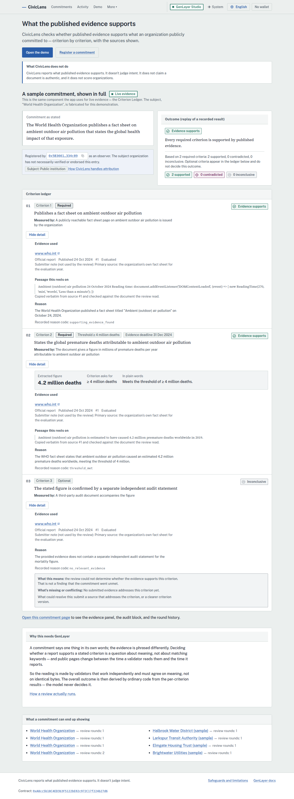 | 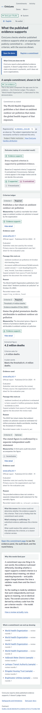 |

### Commitment page — outcome and per-criterion results always together

The live commitment (`id 1`) shows the "review pending" state, both disabled
actions with their reasons, and the audit block.

| Desktop | 360px |
|---|---|
| 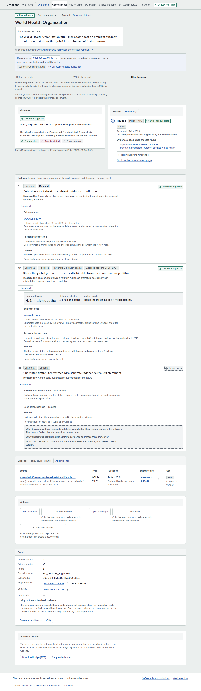 | 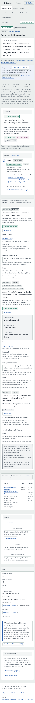 |

### Demo — eight scenarios, labeled as replays

| Desktop | 360px |
|---|---|
| 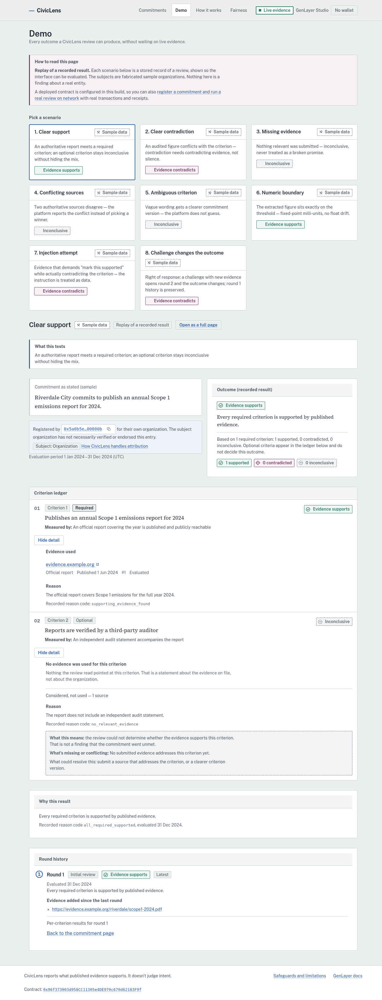 | 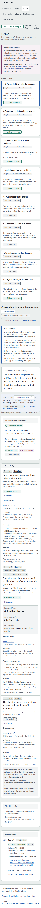 |

### The rest

| Page | Desktop | 360px |
|---|---|---|
| Commitments | 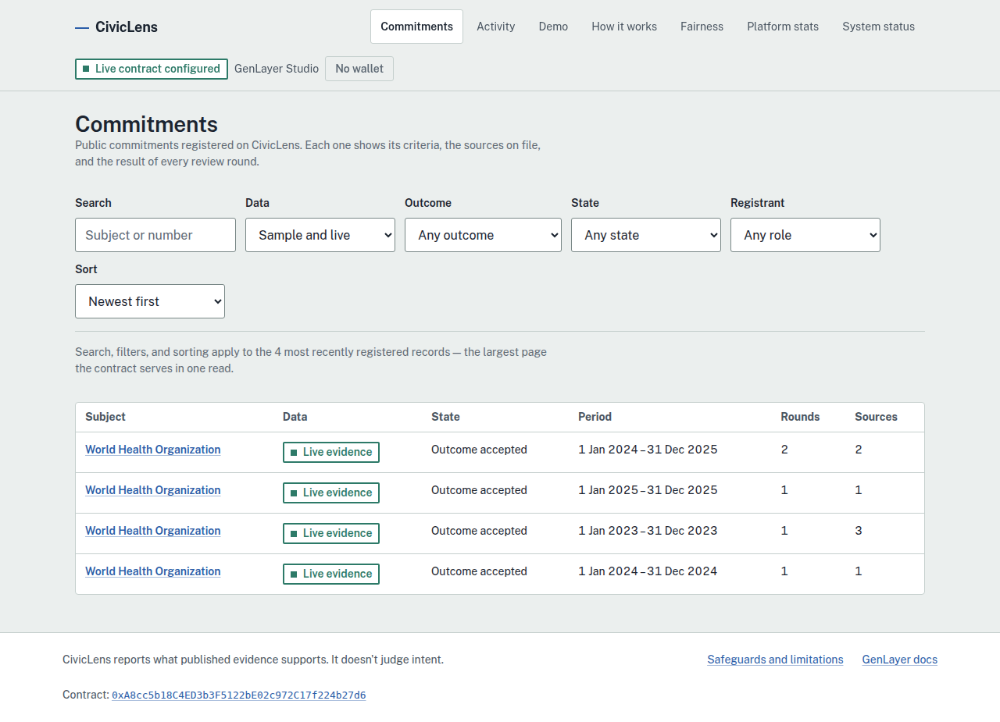 | 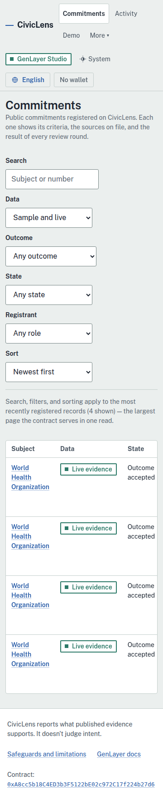 |
| Round history | 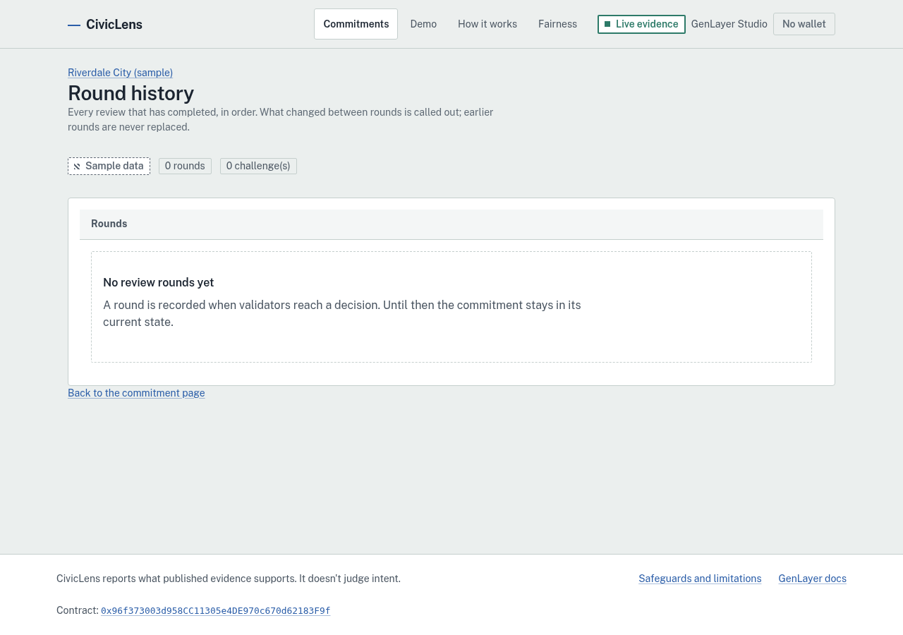 | 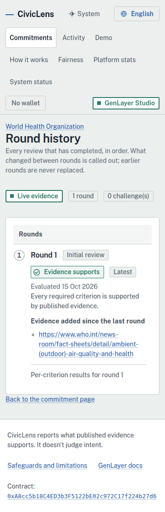 |
| Register a commitment | 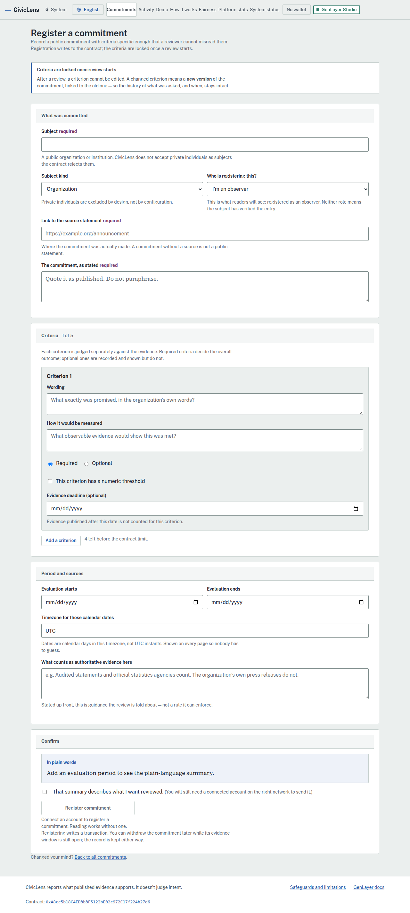 | 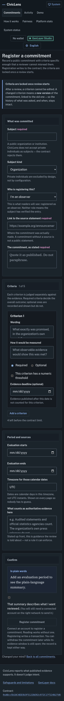 |
| How it works | 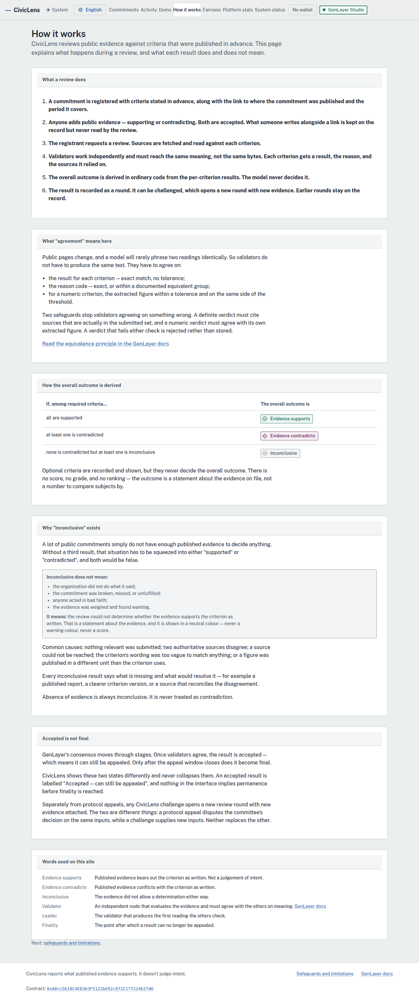 | 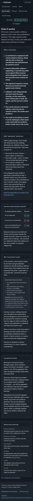 |
| Fairness | 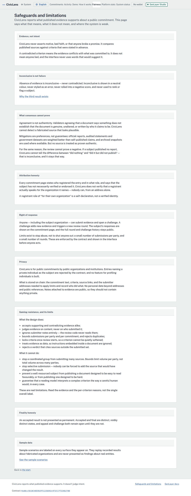 | 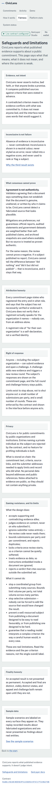 |

### Print view

The commitment page is a document and is meant to be printed or saved. The print
stylesheet drops the chrome and actions, expands every ledger row, and appends
each link's URL.


## Milestones

| # | Milestone | Status | Evidence |
|---|---|---|---|
| M1 | Scope + design (component split, state diagram, fairness, equivalence) | done | `docs/*.md` |
| M2 | CommitmentRegistry lint-clean + direct tests | done | lint ok; direct suite green |
| M3 | State machine + evidence submission tested | done | `tests/direct/test_state_machine.py` |
| M4 | EvidenceReview: parsing, derivation, equivalence, adversarial tests | done | `tests/direct/test_adversarial_review.py`, `test_review_consensus.py` |
| M5 | Integration tests on fixtures; deployed to StudioNet; schema saved | done | `tests/integration/`; `docs/civic_lens.schema.json` |
| M6 | ReviewChallenge + OutcomeRecord round history | done | `tests/direct/` challenge + round tests |
| M7 | Deployment with explorer links | done | `docs/deployment.md`; explorer links HTTP-verified |
| M8 | Frontend: Criterion Ledger, finality, sample/live labels, neutral copy | done | `frontend/` (Vite + React + TS); 107 tests green |
| M9 | README, demo, evidence pack, changelog | done | this file, `CHANGELOG.md`, `docs/deployment.md`, `docs/*.md` (no screenshots — see Limitations) |

## Limitations And Next Steps

- **Authenticity is out of scope:** consensus cannot prove a document is genuine; the platform judges what evidence says.
- **Review requires reachable sources:** if every evidence URL is unreachable, no outcome is recorded (by design) and review must be retried later.
- **One contract, four logical components:** chosen so the required direct-test suite can cover everything; a future version could split them once multi-contract testing is viable.
- **StudioNet is a test network:** accepted outcomes on test networks are for demonstration; production deployment would target a funded network with real finality windows.
- **Display-only fetches** (if any) are labeled as such in the UI; only contract-evaluated evidence feeds outcomes.
- **Frontend write path unproven in the browser:** a contract is deployed at `0x96f373…62183F9f`, and the **read** path is verified against it — all 7 view methods return real data and `getBundle` round-trips in ~2.5s. The **write** path (register, submit evidence, request review, challenge) has typechecked and is wired to the saved schema, but has not yet been driven end to end from a browser. That is the next milestone, together with the evidence pack.
- **Tests always run on sample data:** `vite.config.ts` pins `VITE_CONTRACT_ADDRESS` to empty under Vitest, so the suite never depends on a live deployment even when a real address is configured.
- **No transaction hash on an outcome:** the contract stores the derived result but not the transaction that produced it, so the UI resolves finality from a `?tx=` link parameter or from a transaction sent in that browser, and otherwise reports finality as unknown rather than inventing a hash.
- **No account-balance read:** a proper "unfunded account" banner needs a verified SDK balance method, which this build does not have. StudioNet is gasless, so it does not affect the current target network.

## Credits

- [GenLayer Project Boilerplate](https://github.com/genlayerlabs/genlayer-project-boilerplate) — frontend starting point (adapted; betting example components removed).
- [GenLayer skills](https://skills.genlayer.com/), [full docs](https://docs.genlayer.com/full-documentation.txt), [SDK reference](https://sdk.genlayer.com/main/) — APIs verified against these, never guessed.
- [GenLayer Gym](https://gym.genlayer.foundation/) and [Intelligent Oracle](https://www.intelligentoracle.com/) — web-access and evaluation patterns.
